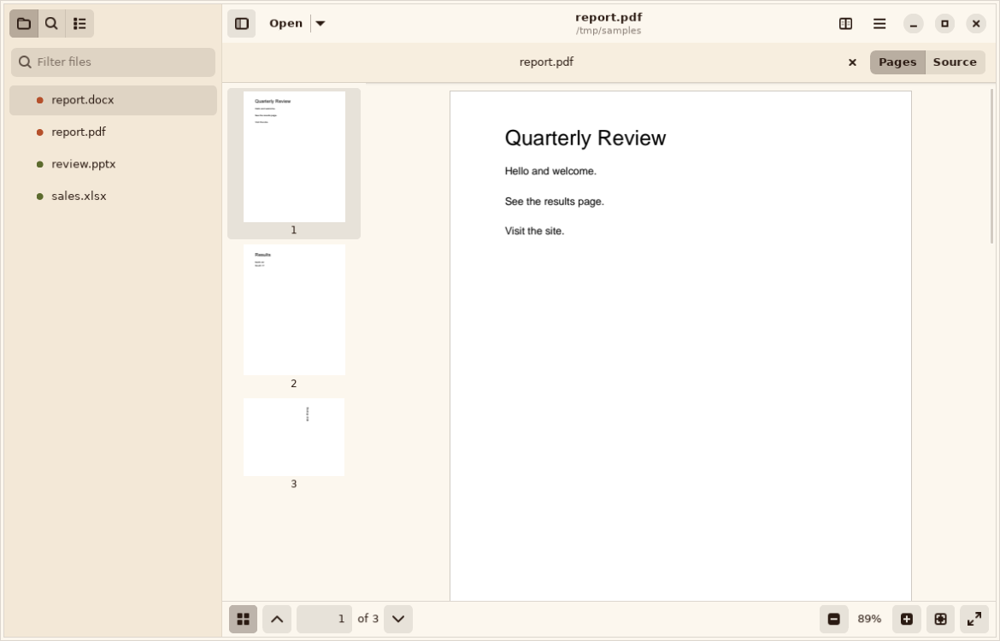
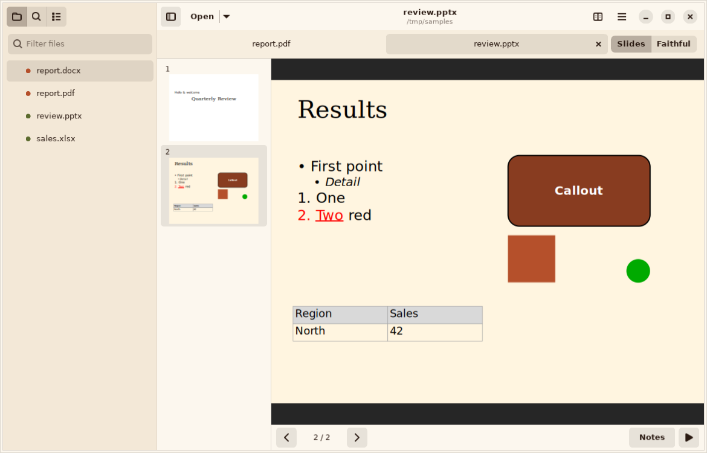
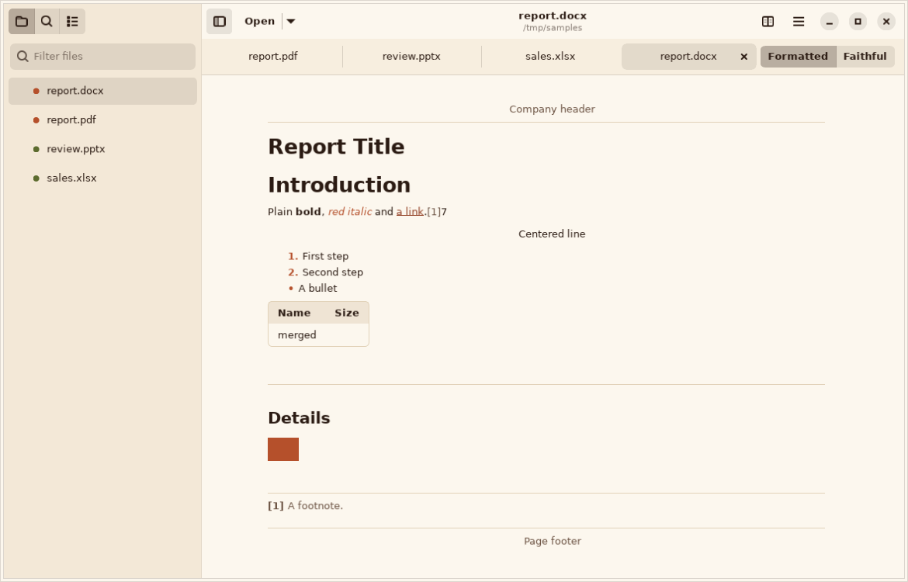
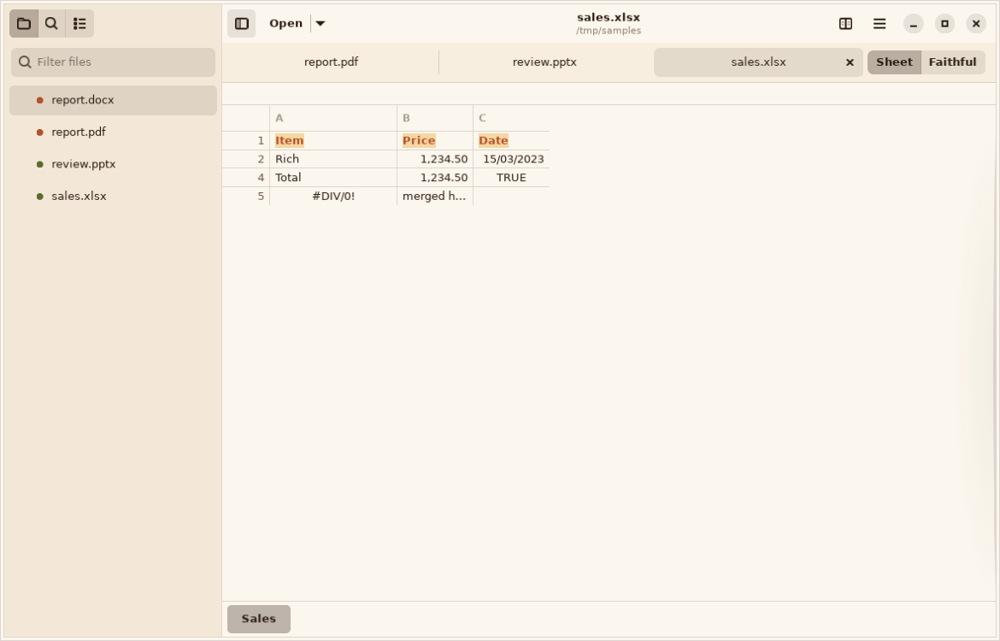
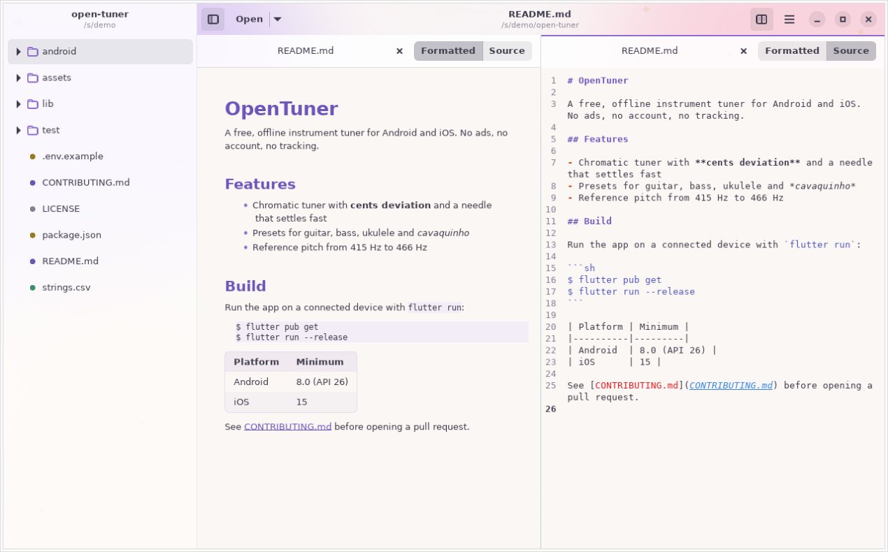

# Open Documents Viewer (Linux)

A fast, read-only viewer for documents, PDF, office files, Markdown, code and
data, for the Linux desktop (GTK 4 + libadwaita). Part of
[libre-apps](https://libre-apps.org): no ads, no account, no tracking,
everything offline.


- Every format is drawn with **native widgets** (no web engine) and loads in
  a thread: big files never freeze the window
- **Formatted ↔ source** with one click (or `Ctrl+E`); office files also get
  a **faithful view** rendered by LibreOffice when it is installed
- Open a **folder** and browse it in a tree, files in **tabs**, **split view**,
  quick open (`Ctrl+P`), find in the file (`Ctrl+F`) and in the whole folder
  (`Ctrl+Shift+F`), an **outline** of headings, slides or bookmarks
- Read-only everywhere, but text is selectable and copyable; "Save a Copy"
  never touches the original
- **Themes**: libre-apps (follows the system light/dark), Pastel, Dracula,
  Kitty and Neon, with an optional background picture; English, Portuguese
  and Spanish

Opening fast is the point: start-up and file-open times are measured
(`--bench`) and a regression is a bug.

| | |
|---|---|
|  |  |
|  |  |
|  |  |

## Formats

| Family | Files | Shown as |
|---|---|---|
| PDF | `.pdf` | Pages rendered by PDFium: zoom, fit, thumbnails, bookmarks, find, select and copy, links, passwords, print; the extracted text as source |
| Word processing | `.docx` `.docm` `.dotx` `.dotm` `.odt` `.ott` `.fodt` `.doc` `.dot` `.rtf` | Formatted text: headings, styles, lists, tables, pictures, notes, headers and footers (`.doc`: the text) |
| Spreadsheets | `.xlsx` `.xlsm` `.xltx` `.xltm` `.ods` `.ots` `.fods` `.xls` `.xlt` | Sheets with number/date formats, styles, merges, hidden rows and columns, the formula bar (never recalculated) |
| Presentations | `.pptx` `.pptm` `.ppsx` `.potx` `.odp` `.otp` `.fodp` `.odg` `.ppt` `.pps` | Slides with shapes, text, pictures and tables, thumbnails, speaker notes, full-screen presentation (`F5`) (`.ppt`: the text) |
| Apple iWork | `.pages` `.numbers` `.key` | The preview picture saved in the file |
| E-books | `.epub` `.fb2` | Chapters, table of contents, pictures, position remembered |
| Markup | `.md` and friends, `.html`, `.ipynb` | Rendered natively and safely (no scripts, no remote content) |
| Mail and contacts | `.eml` `.vcf` `.ics` | Headers, body, attachments you can save; contact cards; events |
| Data | `.csv` `.tsv`, `.json` `.ndjson` `.yaml` `.xml` | Tables of any size with sorting and find; collapsible trees |
| Images | `.png` `.jpg` `.gif` `.webp` `.svg` `.tiff` `.avif` `.heic`… | Zoom, fit, pan, animation, arrows through the folder |
| Code and text | ~200 languages, `.env`, logs, diffs, subtitles | Syntax highlighting, line numbers, minimap, encodings |

Password-protected Word/Excel/PowerPoint files ask for the password and are
decrypted in memory only. Macros are never run.

## Install

Download the latest `linux-v*` release from the [releases page](https://github.com/guilhermefeitosa66/open-documents-viewer/releases):

- **AppImage** (any x86_64 distribution): `chmod +x OpenDocumentsViewer-*.AppImage` and run it.
- **.deb** (Ubuntu 24.04+, Debian 13+, Linux Mint 22+): `sudo apt install ./open-documents-viewer_*_amd64.deb`.
- **Flatpak** (any distribution with Flatpak and Flathub): `flatpak install ./OpenDocumentsViewer-*.flatpak`.
  It runs without network access and sees your files read-only; the faithful view (LibreOffice) is not
  available inside the sandbox.

Then open files from the file manager ("Open With"), or from a terminal:

```sh
open-documents-viewer README.md src/ data.csv
```

## Run from source

```sh
sudo apt install python3-gi python3-gi-cairo gir1.2-gtk-4.0 gir1.2-adw-1 gir1.2-gtksource-5 python3-markdown-it \
  python3-yaml python3-olefile python3-xlrd python3-msoffcrypto-tool
pip install --user pypdfium2   # PDF (the packages bundle it)
make run ARGS="README.md"
```

Development needs only Docker beyond that: `make test` runs the unit and GUI
tests under Xvfb, `make bench` prints the start-up timings, `make deb`,
`make appimage` and `make flatpak` build the packages into `dist/`.

## Keyboard

| | |
|---|---|
| `Ctrl+O` / `Ctrl+Shift+O` | Open file / folder |
| `Ctrl+P` / `Ctrl+Shift+P` | Quick open / command palette |
| `Ctrl+E` | Formatted ↔ source |
| `Ctrl+F` / `Ctrl+Shift+F` | Find in the file / in the folder |
| `Ctrl+Shift+L` | Outline |
| `Ctrl++` / `Ctrl+−` / `Ctrl+0` | Zoom |
| `Ctrl+\` / `Ctrl+K` | Split view / other pane |
| `Ctrl+W` / `Ctrl+R` | Close tab / reload |
| `F5` | Present the slides |
| `F9` / `F11` / `Ctrl+Shift+Enter` | Folder / full screen / focus mode |
| `Ctrl+Shift+S` / `Ctrl+Alt+P` | Save a copy / print |
| `Ctrl+,` / `Ctrl+?` | Preferences / all shortcuts |

## License

Apache License 2.0, see [LICENSE](LICENSE). The libraries used and their
licenses are in [THIRD_PARTY_NOTICES.md](THIRD_PARTY_NOTICES.md): GTK,
libadwaita, GtkSourceView, PyGObject (LGPL-2.1-or-later, dynamically linked),
pypdfium2 and PDFium (Apache-2.0/BSD-3-Clause), markdown-it-py, PyYAML,
olefile, xlrd and msoffcrypto-tool (MIT/BSD). Nothing GPL is linked and
nothing AGPL is used.
