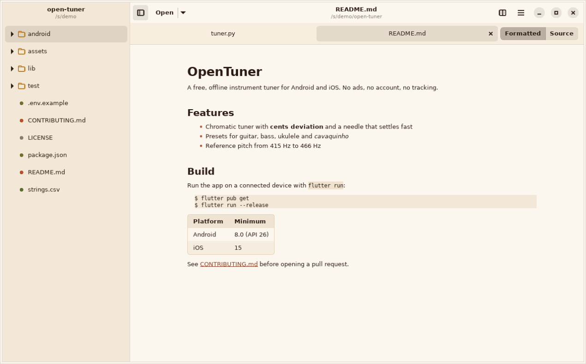
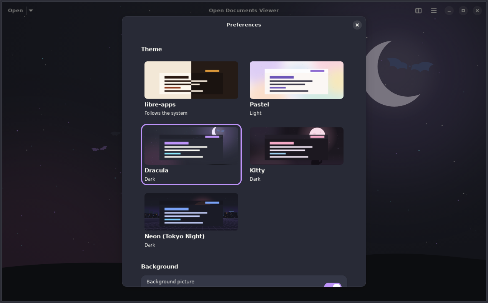

# Open Documents Viewer (Linux)

A fast, read-only viewer for Markdown, text, code and data files, for the
Linux desktop (GTK 4 + libadwaita). Part of [libre-apps](https://libre-apps.org):
no ads, no account, no tracking, everything offline.



- **Markdown** rendered with native widgets (no web engine), one click (or
  `Ctrl+E`) away from the source
- **Code and config** with syntax highlighting: Python, Dart, Kotlin, JS/TS,
  C, Rust, Go, shell… and JSON, YAML, TOML, INI, XML, `.env`
- **CSV / TSV** as a table, millions of rows included, loading while you scroll
- Open a **folder** and browse it in a tree, files in **tabs**, **split view**
  (the same file twice, or two files)
- Read-only everywhere, but text is selectable and copyable; find with `Ctrl+F`
- **Themes**: libre-apps (follows the system light/dark), Pastel, Dracula,
  Kitty and Neon (Tokyo Night), with an optional background picture

Opening fast is the point: start-up and file-open times are measured
(`--bench`) and a regression is a bug.

| | |
|---|---|
|  |  |

Office documents and PDF come in later versions.

## Install

Download the latest `linux-v*` release from the [releases page](https://github.com/guilhermefeitosa66/open-documents-viewer/releases):

- **AppImage** (any x86_64 distribution): `chmod +x OpenDocumentsViewer-*.AppImage` and run it.
- **.deb** (Ubuntu 24.04+, Debian 13+, Linux Mint 22+): `sudo apt install ./open-documents-viewer_*_amd64.deb`.
- **Flatpak** (any distribution with Flatpak and Flathub): `flatpak install ./OpenDocumentsViewer-*.flatpak`.
  It runs without network access and sees your files read-only; the faithful view (LibreOffice) is not
  available inside the sandbox.

Then open files from the file manager ("Open With"), or from a terminal:

```sh
open-documents-viewer README.md src/ data.csv
```

## Run from source

```sh
sudo apt install python3-gi python3-gi-cairo gir1.2-gtk-4.0 gir1.2-adw-1 gir1.2-gtksource-5 python3-markdown-it
make run ARGS="README.md"
```

Development needs only Docker beyond that: `make test` runs the unit and GUI
tests under Xvfb, `make bench` prints the start-up timings, `make deb`,
`make appimage` and `make flatpak` build the packages into `dist/`.

## Keyboard

| | |
|---|---|
| `Ctrl+O` / `Ctrl+Shift+O` | Open file / folder |
| `Ctrl+E` | Formatted ↔ source |
| `Ctrl+F` | Find |
| `Ctrl+\` | Split view |
| `Ctrl+K` | Other pane |
| `Ctrl+W` | Close tab |
| `Ctrl+R` | Reload |
| `F9` | Show the folder |
| `Ctrl+,` | Preferences |

## License

Apache License 2.0, see [LICENSE](LICENSE). The libraries used and their
licenses are in [THIRD_PARTY_NOTICES.md](THIRD_PARTY_NOTICES.md): GTK,
libadwaita, GtkSourceView, PyGObject (LGPL-2.1-or-later, dynamically linked)
and markdown-it-py (MIT).
